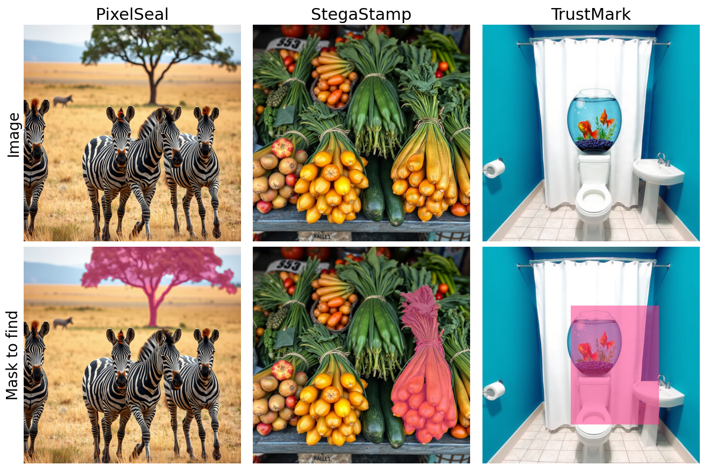
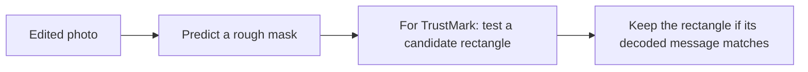
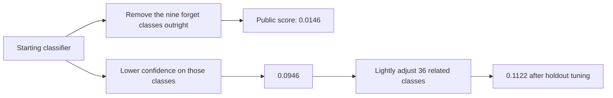

# Teletubbies · CISPA × Fraunhofer AISEC Hackathon

**Paris 2026**  /  [Presentation slides](slides/Teletubbies_CISPA_Paris_2026.pptx)  /  [Task 2 final predictions (CSV)](Task%202%20-%20Model%20Equality%20Testing/final_submission.csv)

| Challenge | What did we predict or change? | Best public result |
| :--- | :--- | ---: |
| 01 · [Watermark localization](Task%201%20-%20Watermark%20Localization/) | A mask showing where an image still carries a watermark | **0.7141** mIoU |
| 02 · [Model equality](Task%202%20-%20Model%20Equality%20Testing/) | Which language-model endpoints share exactly the same weights | **1.00** |
| 03 · [Unlearning](Task%203%20-%20Unlearning/) | An image classifier that behaves more like one retrained without the forget set | **0.1122** |

These are public leaderboard results. The three tasks use different metrics; the numbers are not comparable across rows.

## 01 / Where is the invisible watermark?

An edited photo can contain both marked and unmarked pixels. The first row below shows three training images. The second shows the **target**, not our prediction: pink highlights exactly the region our mask should recover.

**Why decode?** A segmentation model can suggest a plausible outline even where the watermark is absent. The known message gives us a second check. Confirming 60 TrustMark rectangles moved the baseline from 0.6930 to 0.7062 mIoU; correcting PixelSeal holes and realigning rectangle edges took it to **0.7141**.

[Method and all four measured steps →](Task%201%20-%20Watermark%20Localization/README.md)

## 02 / Different answers. Same model?

A chatbot that sounds different may just be using a different system prompt. A quantized chatbot may sound identical while using **different weights**. The official practice set shows both cases:

**Our test:** take an actual reply and give an open checkpoint the same prompt. At each step, measure how likely it thought the endpoint’s next token was. Comparing these measurements across many replies helped us separate changes in sampling from changes in weights.

We submitted **three shared-weight groups** and left the other 16 endpoints separate. Several groupings tied at **1.00** publicly; that tie cannot verify decisions on hidden pairs.

[Task 2 walkthrough →](Task%202%20-%20Model%20Equality%20Testing/)  ·  [Token-scoring code](Task%202%20-%20Model%20Equality%20Testing/score_wb.py#L72-L90)  ·  [All 33 predictions](Task%202%20-%20Model%20Equality%20Testing/final_submission.csv)

## 03 / What should forgetting look like?

The target is **not** a classifier that always gets the 3,500 forget images wrong. It is one that behaves like a classifier trained *without* them, while still recognizing other images. The distinction shows up in the results:

**Why soften rather than delete?** A retrained classifier can still recognize an image it never trained on. Forcing its true class probability to zero can therefore move the output *further* from the reference. A modest confidence change worked better in our runs.

[Method and variant scores →](Task%203%20-%20Unlearning/README.md)

---

**Data & reproducibility.** The [download script](download_datasets.py) fetches the official datasets and checks their SHA-256 hashes. Task 2's [offline CSV recipe](Task%202%20-%20Model%20Equality%20Testing/README.md#try-it-without-the-competition-api) needs only Python; no download or competition API key is required.
