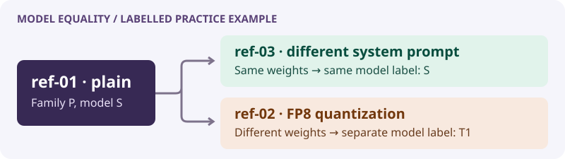
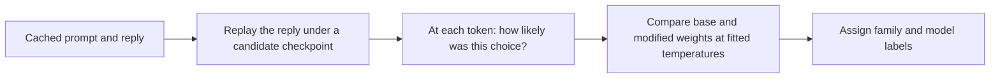

# Task 2 · Model Equality Testing

[Task statement](Model%20Equality%20Testing.pdf) · [Final submission](final_submission.csv) · [Token scorer](score_wb.py) · [Cached answers and analysis](../task2/loop/)

Two language models can say different things because they sample different words, not because their weights differ. The challenge was to give each of **33 anonymous endpoints** two labels: a checkpoint *family* and an exact *model* within that family.



These are three of the nine [official practice labels](practice_answers.csv), not guesses about the test set. We used the labelled endpoints to check our detectors before applying them to the anonymous ones.

## How we went from replies to weights



Suppose an endpoint replies “Paris”. Rather than asking it again and hoping for the same word, we give an open model the **same prompt** and measure the probability it assigned to the actual first token. For each later token, we also give it the preceding tokens of the real reply. This is *teacher forcing*: we compare explanations of the **same observation**, rather than comparing two random generations.

| Clue | How it changes the decision | Implementation |
| --- | --- | --- |
| Temperature or top-k/top-p | Sharper probabilities or missing low-ranked tokens can reflect how words are sampled. That alone is not a reason to split the weights. | [Token probabilities and ranks](score_wb.py#L72-L90) · [truncation test](../task2/loop/wb_trunc.py) |
| FP8 quantization | Score the **same replies** under base and simulated FP8 weights. Fit temperature separately before comparing likelihoods. | [Quantization](score_wb.py#L21-L49) · [likelihood comparison](../task2/loop/wb_llr.py) |
| LoRA adapter | Even at a fitted temperature, an adapter can change which token wins and when a reply stops. | [Stop-rate check](../task2/loop/wb_eos.py) · [top-token check](../task2/loop/wb_table.py) |
| System prompt or text watermark | A changed prompt or repeated opening can alter the text while leaving the checkpoint unchanged. | [Prompt rescoring](score_wb.py#L65-L72) · [repeated openings](../task2/loop/rep_prefix.py) |

## What we submitted

Endpoint numbers below omit the `ep-` prefix. **Each row is one shared model** in our final CSV; each of the other 16 endpoints gets its own model label, not one collective “other” label.

| Family | Open checkpoint | Predicted shared-weight group |
| --- | --- | --- |
| A | Qwen2.5-3B-Instruct | 04 · 12 · 14 · 23 · 33 |
| B | Qwen2.5-1.5B-Instruct | 06 · 07 · 08 · 20 · 30 · 32 |
| C | Llama-3.2-1B-Instruct | 10 · 13 · 16 · 27 · 29 · 31 |

**Best public score: 1.00.** Adding `ep-13` to C raised the public score from 0.70 to 0.85; adding `ep-32` to B brought it to 1.00. Multiple later variants tied, including the selected grouping (submission **4035**). The tie does **not** establish that every hidden pair is correct: `ep-12` was selected on local weight evidence. [Submission log and measurements](../task2/loop/c19d/README.md) · [Research notebook](../task2/loop/NOTES.md)

## Try it without the competition API

**Rebuild the submitted answer.** From the repository root, this writes a new CSV from our selected groups using only Python's standard library. It neither queries endpoints nor submits anything.

```sh
python3 task2/loop/mkcsv.py rebuilt.csv "04 12 14 23 33|06 07 08 20 30 32|10 13 16 27 29 31"
```

Compare it with [final_submission.csv](final_submission.csv): each row is `endpoint,family,model`. For example, `ep-06` and `ep-08` have the same `family` **and** `model`; `ep-22` shares their `family` only.

**Inspect one replay.** With NumPy, PyTorch and Transformers installed and the open Qwen checkpoint available locally or downloadable from Hugging Face, run this from the repository root. The [cached replies](../task2/loop/data/ep_long.jsonl) already include the endpoint output; the scorer appends local token statistics to `replay.jsonl`.

```sh
python3 "Task 2 - Model Equality Testing/score_wb.py" \
  --model Qwen/Qwen2.5-1.5B-Instruct --data task2/loop/data/ep_long.jsonl \
  --endpoints ep-32 --limit 1 --out replay.jsonl
```

One reply illustrates the mechanism; the grouping used many replies and the reference checks above. The [full experiment workspace](../task2/loop/) retains the original scripts, collected outputs and candidate submissions.
